# Full-Stack Deployment: The EpicBook on Microsoft Azure

[](https://azure.microsoft.com/)
[](https://ubuntu.com/)
[](https://nodejs.org/)
[](https://nginx.org/)
[](https://azure.microsoft.com/en-us/products/mysql/)

---

## 1. Project Overview

**Category:** Cloud Architecture / DevOps / Full-Stack Hosting  
**Cloud Provider:** Microsoft Azure  
**Region:** `South Africa North`  
**Application:** The EpicBook (Node.js, Express, Sequelize, MySQL, Nginx)

### Objective
Design and provision a secure, multi-tier enterprise cloud infrastructure on Microsoft Azure to host **The EpicBook** e-commerce application. 

The public-facing frontend and backend application run on an Ubuntu Virtual Machine inside a public subnet, while the managed relational database (**Azure Database for MySQL Flexible Server**) is completely isolated inside a private subnet using **Virtual Network Integration** and dedicated subnet delegation.

---

## 2. High-Level Architecture

```mermaid
flowchart TD
    subgraph Internet ["Public Internet"]
        Client["Browser Client / Shopper"]
        Admin["DevOps Admin Terminal (SSH)"]
    end

    subgraph Azure ["Microsoft Azure Cloud (Region: South Africa North)"]
        subgraph VNet ["Virtual Network: epicbook-vnet (10.0.0.0/16)"]
            
            subgraph PublicSubnet ["Public Application Subnet: public-subnet (10.0.1.0/24)"]
                NSG_Pub["Public NSG (epicbook-public-nsg)<br/>Inbound: Port 80 (HTTP) & Port 22 (SSH)"]
                PIP["Public IP: 40.123.244.184"]
                NIC["Network Interface: epicbook-vm-nic (10.0.1.4)"]
                
                subgraph VM ["Azure Virtual Machine: epicbook-vm"]
                    Nginx["Nginx Reverse Proxy<br/>(Listens: Port 80)"]
                    NodeApp["EpicBook Backend (Node.js/Express)<br/>(Listens: Internal Port 8080)"]
                    Sequelize["Sequelize ORM<br/>(TLS/SSL Transport)"]
                end
            end

            subgraph PrivateSubnet ["Private Database Subnet: private-db-subnet (10.0.2.0/24)"]
                NSG_Priv["Private NSG (epicbook-private-nsg)<br/>Inbound: Port 3306 Restricted to 10.0.1.0/24"]
                Delegation["Subnet Delegation:<br/>Microsoft.DBforMySQL/flexibleServers"]
                MySQL["Azure Database for MySQL Flexible Server<br/>epicbook-mysql-jamiu.mysql.database.azure.com<br/>(Private IP Only - Zero Public Access)"]
                DB[("Database: bookstore<br/>Tables: Author, Book, Cart, Checkout")]
            end

        end
    end

    Client -->|HTTP :80| PIP
    Admin -->|SSH :22| PIP
    PIP --> NIC
    NIC --> NSG_Pub
    NSG_Pub --> Nginx
    Nginx -->|Internal Proxy Pass| NodeApp
    NodeApp --> Sequelize
    Sequelize -->|TCP :3306 (SSL/TLS)| NSG_Priv
    NSG_Priv --> MySQL
    MySQL --> DB
```

---

## 3. Step-by-Step Implementation & Proof of Execution

---

### Phase 1: Network & Security Group Provisioning

#### Task 1: Virtual Network & Subnet Segmentation
Configured an Azure Virtual Network (`10.0.0.0/16`) divided into two functional tiers:
1. `public-subnet` (`10.0.1.0/24`): Dedicated to internet-facing compute instances.
2. `private-db-subnet` (`10.0.2.0/24`): Delegated to `Microsoft.DBforMySQL/flexibleServers` to allow Azure managed MySQL to handle dynamic network routing internally.

**Proof of Execution:**
> *Screenshot 1: Virtual Network address space showing `public-subnet` and delegated `private-db-subnet`.*

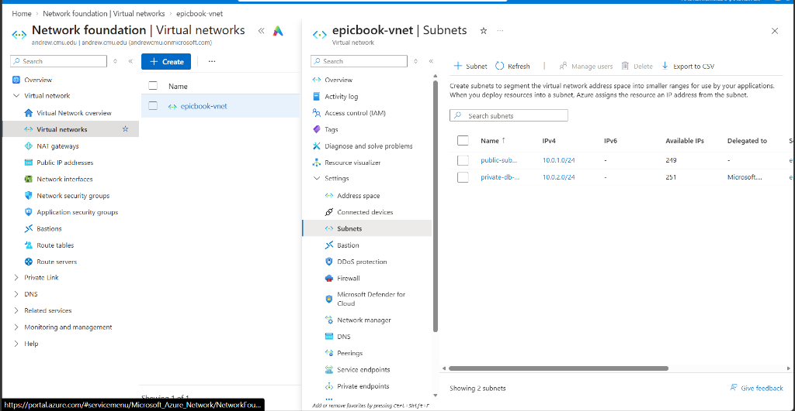

---

#### Task 2: Network Security Groups (Public & Private)
Configured micro-segmentation using stateful Network Security Groups (NSGs):
* **`epicbook-public-nsg`:** Allows Port 80 (HTTP) for public web traffic and Port 22 (SSH) for administrative access.
* **`epicbook-private-nsg`:** Allows MySQL traffic on Port 3306 **strictly from `10.0.1.0/24`** (the public subnet). All external traffic to Port 3306 is explicitly blocked.

**Proof of Execution:**
> *Screenshot 2: Public NSG inbound rules (Ports 80 & 22) and Private NSG inbound rule (Port 3306 restricted to `10.0.1.0/24`).*

**Public NSG (`epicbook-public-nsg`):**
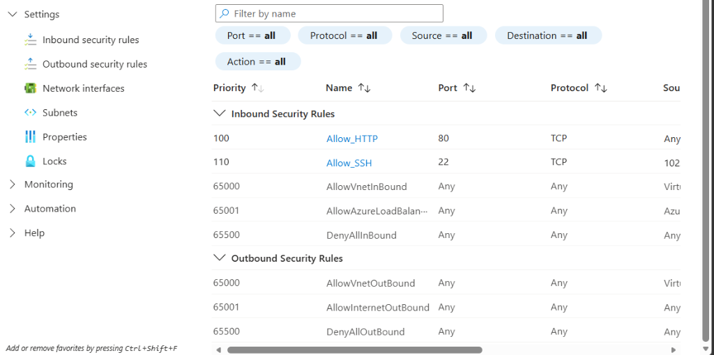

**Private Database NSG (`epicbook-private-nsg`):**
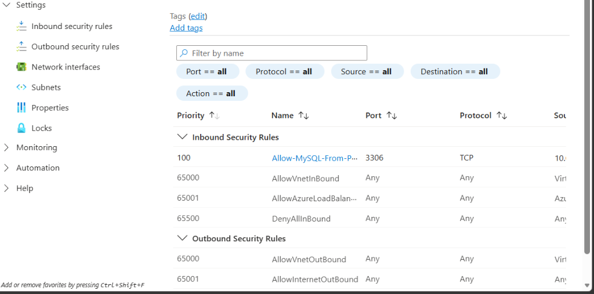

---

#### Task 3: Network Interface & Public IP Association
Created the standalone Network Interface Card (`epicbook-vm-nic`) in `public-subnet` with dynamic private IP allocation (`10.0.1.4`) and associated a Standard Static Public IP address.

**Proof of Execution:**
> *Screenshot 3: Network Interface IP configuration showing private IP and attached Public IP.*

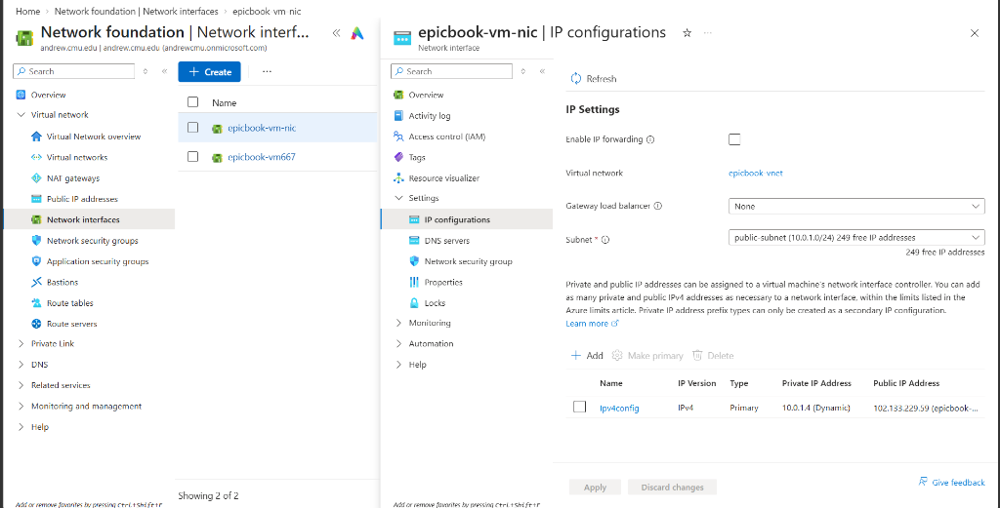

---

### Phase 2: Compute & Web Server Provisioning

#### Task 4: Deploy Ubuntu Virtual Machine
Provisioned the compute instance `epicbook-vm` running Ubuntu 24.04 LTS (`Standard_B2ats_v2`) in `South Africa North` attached to `epicbook-vm-nic`.

**Proof of Execution:**
> *Screenshot 4: Virtual Machine overview showing active running status, VM size, and Public IP `40.123.244.184`.*

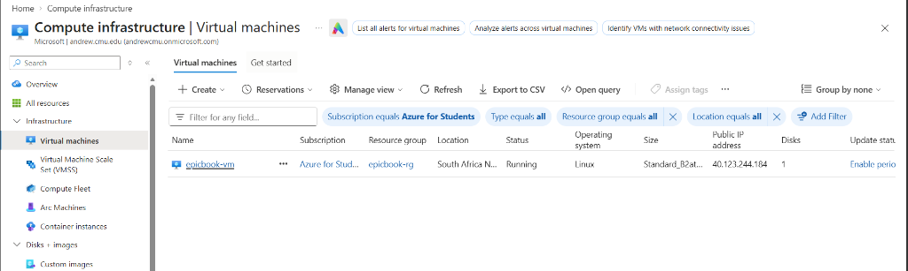

---

#### Task 5: Install Server Toolchain & Runtimes
Updated package repositories and installed Nginx, Git, MySQL Client, and Node.js 20 LTS via the official NodeSource repository.

**Commands executed:**
```bash
sudo apt update && sudo apt upgrade -y
sudo apt install -y nginx git mysql-client curl
curl -fsSL https://deb.nodesource.com/setup_20.x | sudo -E bash -
sudo apt install -y nodejs
node -v && npm -v && git --version && nginx -v && mysql --version
```

**Proof of Execution:**
> *Screenshot 5: Terminal output showing verified versions for Node.js (v20.20.2), npm (10.8.2), Git (2.43.0), Nginx (1.24.0), and MySQL Client (8.0.46).*

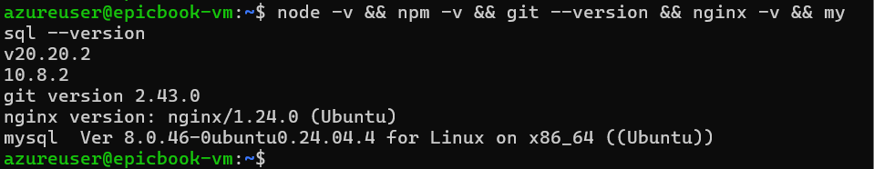

---

### Phase 3: Managed Database Tier (Azure MySQL Flexible Server)

#### Task 6: Provision MySQL Flexible Server with Private Access
Deployed Azure Database for MySQL Flexible Server (`epicbook-mysql-jamiu`) inside `private-db-subnet`. Public access was completely disabled, and VNet Integration was configured with Azure Private DNS.

**Proof of Execution:**
> *Screenshot 6 & 7: MySQL server overview (Status: Ready) and Networking blade showing attachment to `private-db-subnet` with enforced TLS/SSL.*

**MySQL Flexible Server Overview:**
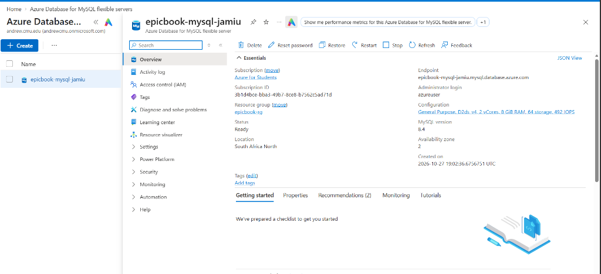

**MySQL Private Subnet Delegation:**
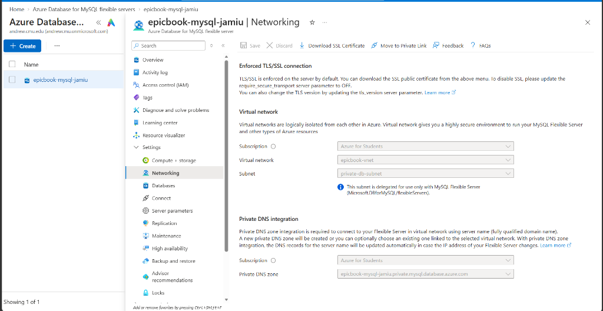

---

#### Task 7: Database Schema Initialization & Inventory Seeding
Connected from the VM to the private database endpoint, created the `bookstore` database, and imported the relational schema and seed records.

**Commands executed:**
```bash
# Clone the application repository
git clone https://github.com/pravinmishraaws/theepicbook.git ~/theepicbook

# Create database
mysql -h epicbook-mysql-jamiu.mysql.database.azure.com -u azureuser -p -e "CREATE DATABASE bookstore;"

# Import Schema (Creates tables: author, book, cart, checkout)
mysql -h epicbook-mysql-jamiu.mysql.database.azure.com -u azureuser -p bookstore < ~/theepicbook/db/BuyTheBook_Schema.sql

# Seed Author and Book Records
mysql -h epicbook-mysql-jamiu.mysql.database.azure.com -u azureuser -p bookstore < ~/theepicbook/db/author_seed.sql
mysql -h epicbook-mysql-jamiu.mysql.database.azure.com -u azureuser -p bookstore < ~/theepicbook/db/books_seed.sql
```

**Proof of Execution:**
> *Screenshot 8: Verification query confirming tables exist and initial author and book seed data are populated.*

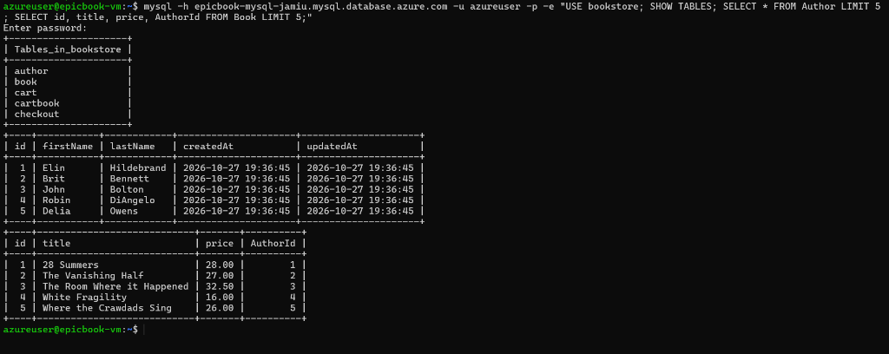

---

### Phase 4: Application Deployment & Reverse Proxy

#### Task 8: Install Dependencies & Configure Database Connection
Installed npm packages into `node_modules/` and configured `config/config.json` with the private Azure MySQL endpoint, enabling SSL options (`dialectOptions: { ssl: { rejectUnauthorized: false } }`) to satisfy Azure's `require_secure_transport = ON` policy.

#### Task 9: Configure Nginx as a Reverse Proxy
Configured Nginx on Port 80 to proxy incoming web traffic internally to the Node.js application running on Port 8080.

**Nginx Configuration (`/etc/nginx/sites-available/epicbook`):**
```nginx
server {
    listen 80;
    server_name _;

    location / {
        proxy_pass http://127.0.0.1:8080;
        proxy_http_version 1.1;
        proxy_set_header Host $host;
        proxy_set_header X-Real-IP $remote_addr;
        proxy_set_header X-Forwarded-For $proxy_add_x_forwarded_for;
        proxy_set_header X-Forwarded-Proto $scheme;
    }
}
```

**Proof of Execution:**
> *Screenshot 9 & 10: `node_modules/` directory created, Nginx configuration file, and successful `sudo nginx -t` syntax test.*

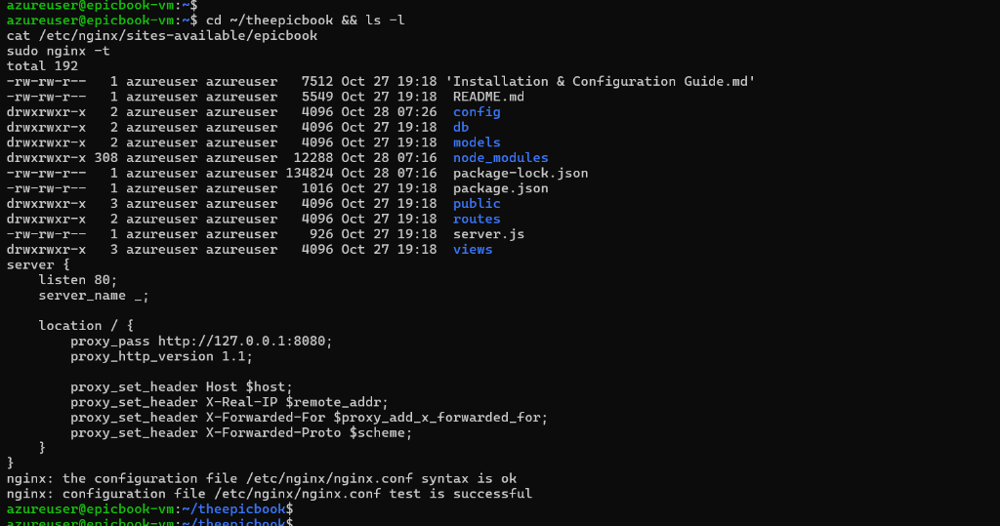

---

#### Task 10: Start Application & Verify Port 8080
Started the Node.js backend (`npm run start`) and verified via `ss -tulpn` that Node.js was actively listening on internal port 8080.

**Commands executed:**
```bash
cd ~/theepicbook
npm run start

# In second terminal:
sudo ss -tulpn | grep 8080
```

**Proof of Execution:**
> *Screenshot 11: Terminal verifying active TCP listener on Port 8080 by node process (PID 4343).*

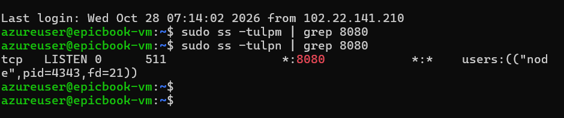

---

### Phase 5: End-to-End Validation & Live Testing

#### Task 11: Access Live Store via Public IP
Navigated to `http://40.123.244.184` in the browser. The request arrived at Port 80, Nginx proxied it to Node.js, Express queried Azure MySQL over Port 3306 via the private subnet, and rendered the complete bookstore catalog.

**Proof of Execution:**
> *Screenshot 12: Production EpicBook web store live in the browser via public IP address.*

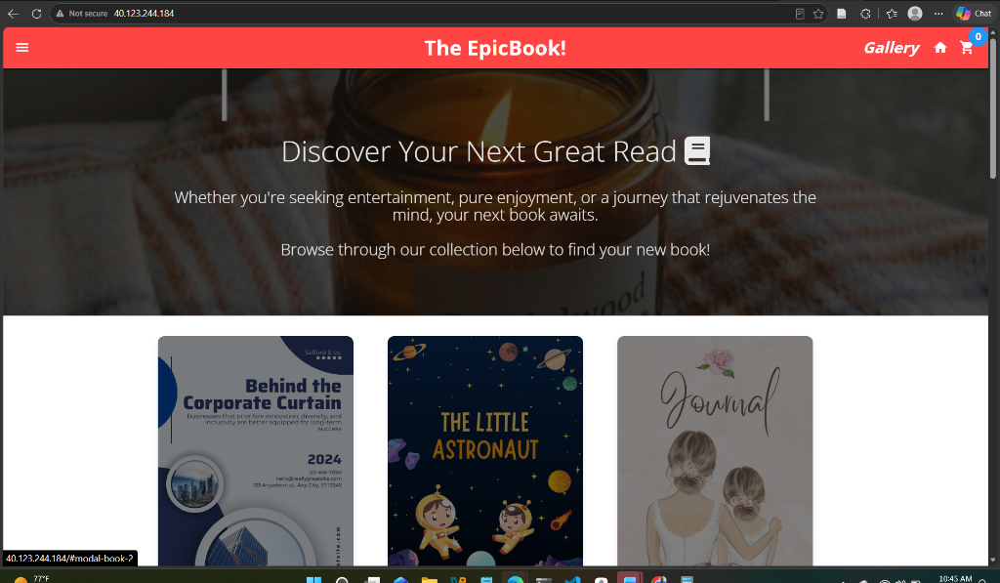

---

#### Task 12: Verify Database-Backed Action (Cart Addition)
Added a book (*The Vanishing Half*, \$17.00) to the shopping cart in the browser. Queried the MySQL database from the terminal to prove that the frontend action executed a dynamic `INSERT INTO Cart` in the cloud database.

**Verification query:**
```sql
SELECT * FROM Cart;
```

**Proof of Execution:**
> *Screenshot 13: Terminal proving record was written to the `Cart` table in Azure Database for MySQL.*

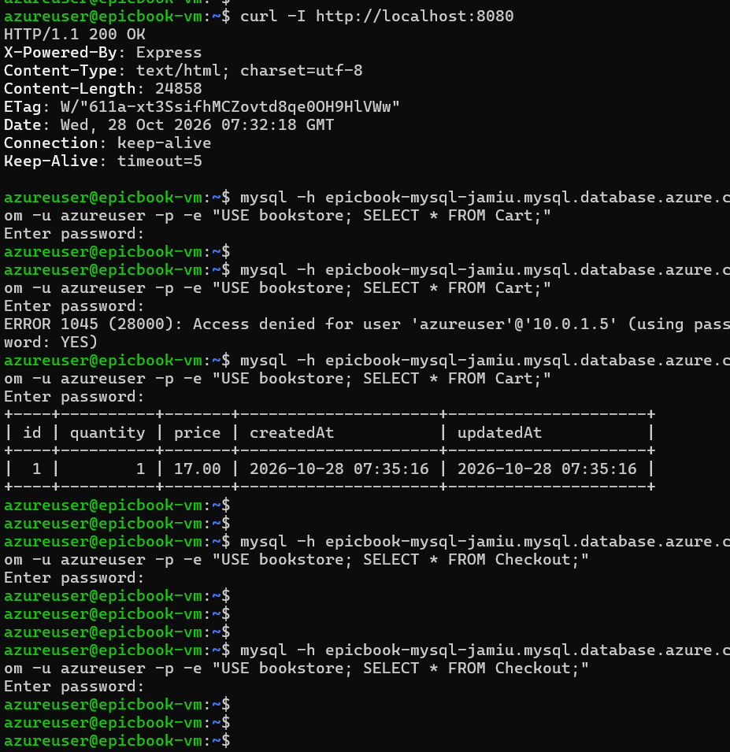

---

## 4. Key Engineering Takeaways

1. **Defense-in-Depth Architecture:** Placing the database inside a private subnet with subnet delegation and restricted NSGs ensures zero exposure to public internet attacks.
2. **Reverse Proxy Benefits:** Utilizing Nginx in front of Node.js protects the backend runtime, standardizes HTTP traffic on port 80, and provides connection management.
3. **Encrypted In-Transit Data:** Enforcing TLS/SSL transport between the application layer and MySQL ensures compliance with regulatory standards (e.g., PCI-DSS, SOC 2).
4. **Decoupled State:** Isolating data in a managed cloud database ensures the application compute layer remains stateless and easily replaceable without risking data loss.

---

## 👤 Author

* **Name:** Jamiu Dahunsi  
* **Role:** Cloud & DevOps Engineer  
* **Project:** Full-Stack Cloud Deployment on Microsoft Azure
